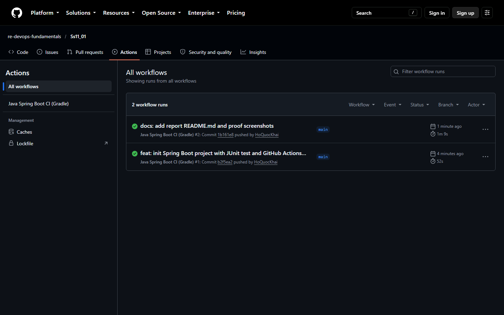
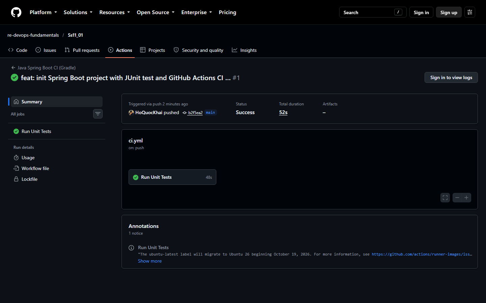

# BÁO CÁO THỰC HÀNH: KHỞI TẠO WORKFLOW CHẠY UNIT TEST TỰ ĐỘNG CHO JAVA SPRING BOOT VỚI GRADLE

---

- **Môn học**: DevOps Fundamentals (IT-209)
- **Session**: 11 - CI/CD Pipeline với GitHub Actions
- **Bài tập**: Bài 1 - Khởi tạo Workflow chạy Unit Test tự động cho Java Spring Boot với Gradle
- **Học viên**: Hồ Quốc Khải
- **Email**: khaiho6040@gmail.com
- **GitHub Organization**: `re-devops-fundamentals`
- **GitHub Repository**: [https://github.com/re-devops-fundamentals/Ss11_01](https://github.com/re-devops-fundamentals/Ss11_01)
- **Đường dẫn gợi ý nộp bài**: `homework/session_11/ex1/`

---

## 1. MỤC TIÊU VÀ YÊU CẦU

### 1.1. Mục tiêu
- Xây dựng quy trình Tích hợp liên tục (Continuous Integration - CI) tự động hóa bằng GitHub Actions cho ứng dụng Java Spring Boot quản lý bằng Gradle.
- Tự động chuẩn bị môi trường chạy kịch bản thử nghiệm: runner Ubuntu mới nhất, cài đặt Java JDK 17 (Temurin), cấp quyền thực thi cho Gradle Wrapper và thực thi kiểm thử JUnit (`./gradlew test`).
- Đảm bảo kiểm tra chất lượng mã nguồn tự động ngay khi có commit mới được đẩy (push) lên nhánh `main`.

### 1.2. Yêu cầu chi tiết
1. Trong thư mục repository dự án Spring Boot (Gradle), khởi tạo tệp `.github/workflows/ci.yml`.
2. Khai báo điều kiện kích hoạt workflow khi có sự kiện `push` lên nhánh `main`.
3. Định nghĩa Job `test` (tên hiển thị: `Run Unit Tests`) chạy trên runner `ubuntu-latest`:
   - Checkout mã nguồn với `actions/checkout@v5`.
   - Cài đặt Java JDK 17 với `actions/setup-java@v5` (distribution: `temurin`).
   - Cấp quyền thực thi cho script wrapper: `run: chmod +x gradlew`.
   - Thực thi câu lệnh kiểm thử: `run: ./gradlew test`.
4. Đẩy mã nguồn lên GitHub, truy cập tab Actions trên GitHub Repository.
5. Xác nhận Job `Run Unit Tests` khởi chạy tự động, thực thi JUnit test bằng Gradle và đạt trạng thái tích xanh (**Success**).

---

## 2. CẤU TRÚC THƯ MỤC DỰ ÁN

```
Ss11/1/
├── .github/
│   └── workflows/
│       └── ci.yml               # Kịch bản GitHub Actions CI workflow
├── gradle/
│   └── wrapper/
│       ├── gradle-wrapper.jar   # Gradle wrapper executable archive
│       └── gradle-wrapper.properties # Cấu hình phiên bản Gradle (9.5.1)
├── src/
│   ├── main/
│   │   ├── java/com/example/tasks/
│   │   │   ├── controller/
│   │   │   │   └── TaskController.java     # REST Controller quản lý task
│   │   │   ├── model/
│   │   │   │   └── Task.java               # Entity Task model
│   │   │   └── TaskApiApplication.java    # Spring Boot Main Application
│   │   └── resources/
│   │       └── application.properties     # Cấu hình ứng dụng
│   └── test/
│       └── java/com/example/tasks/
│           ├── controller/
│           │   └── TaskControllerTest.java     # JUnit 5 unit test kiểm tra logic Controller
│           └── TaskApiApplicationTests.java    # Spring Boot Context load test
├── .gitignore                   # Loại trừ file build và cache
├── build.gradle                 # Cấu hình Gradle build & Java 17 toolchain
├── gradlew                      # Gradle wrapper script (Linux/macOS)
├── gradlew.bat                  # Gradle wrapper script (Windows)
├── settings.gradle              # Cấu hình tên project (task-api)
├── actions_success.png          # Ảnh chụp màn hình tab Actions tích xanh
├── job_run_success.png          # Ảnh chụp chi tiết Job Run Unit Tests hoàn thành
└── README.md                    # Báo cáo kỹ thuật chi tiết
```

---

## 3. NỘI DUNG KỊCH BẢN GITHUB ACTIONS WORKFLOW

Tệp kịch bản được đặt tại: `.github/workflows/ci.yml`

```yaml
name: Java Spring Boot CI (Gradle)
 
on:
  push:
    branches: [ "main" ]
 
jobs:
  test:
    name: Run Unit Tests
    runs-on: ubuntu-latest
 
    steps:
      - name: Checkout mã nguồn
        uses: actions/checkout@v5
 
      - name: Thiết lập môi trường Java JDK 17
        uses: actions/setup-java@v5
        with:
          java-version: '17'
          distribution: 'temurin'
 
      - name: Cấp quyền cho Gradle Wrapper
        run: chmod +x gradlew
 
      - name: Thực thi JUnit Test với Gradle
        run: ./gradlew test
```

### Phân tích chi tiết từng khối chỉ thị:

1. **`name: Java Spring Boot CI (Gradle)`**:
   - Đặt tên định danh trực quan cho workflow, hiển thị trên giao diện tab Actions của GitHub.
2. **`on: push: branches: [ "main" ]`**:
   - Bộ kích hoạt (Trigger Event): Workflow sẽ tự động được kích hoạt mỗi khi có commit mới được push trực tiếp hoặc merge vào nhánh `main`.
3. **`jobs: test:`**:
   - Khai báo một công việc thực thi mang định danh `test`.
   - `name: Run Unit Tests`: Tên hiển thị của Job trong giao diện pipeline.
   - `runs-on: ubuntu-latest`: Chỉ định runner môi trường máy ảo Ubuntu bản mới nhất do GitHub cung cấp.
4. **`steps` (Các bước thực thi tuần tự)**:
   - **Step 1 - Checkout mã nguồn (`actions/checkout@v5`)**: Tải toàn bộ mã nguồn của repository tại commit kích hoạt về không gian làm việc của runner (`$GITHUB_WORKSPACE`).
   - **Step 2 - Thiết lập môi trường Java JDK 17 (`actions/setup-java@v5`)**: Cài đặt OpenJDK phiên bản 17 từ nhà phân phối Eclipse Temurin (Adoptium), thiết lập biến môi trường `JAVA_HOME` và bổ sung `java`/`javac` vào biến `$PATH`.
   - **Step 3 - Cấp quyền cho Gradle Wrapper (`run: chmod +x gradlew`)**: Đảm bảo tệp shell script `gradlew` có cờ thực thi (`+x`) trên hệ điều hành Linux runner.
   - **Step 4 - Thực thi JUnit Test với Gradle (`run: ./gradlew test`)**: Sử dụng Gradle Wrapper để tải các thư viện phụ thuộc, biên dịch mã nguồn Java, biên dịch mã kiểm thử và thực thi toàn bộ các bài kiểm thử JUnit 5. Nếu có bất kỳ test nào thất bại, lệnh sẽ trả về mã lỗi khác 0 và đánh dấu Job thất bại (Red).

---

## 4. CẤU HÌNH DỰ ÁN GRADLE VÀ CÁC BÀI KIỂM THỬ JUNIT

### 4.1. Tệp cấu hình `build.gradle`
```groovy
plugins {
	id 'java'
	id 'org.springframework.boot' version '4.1.0'
	id 'io.spring.dependency-management' version '1.1.7'
}

group = 'com.example'
version = '0.0.1-SNAPSHOT'

java {
	sourceCompatibility = JavaVersion.VERSION_17
	targetCompatibility = JavaVersion.VERSION_17
	toolchain {
		languageVersion = JavaLanguageVersion.of(17)
	}
}

repositories {
	mavenCentral()
}

dependencies {
	implementation 'org.springframework.boot:spring-boot-starter-webmvc'
	testImplementation 'org.springframework.boot:spring-boot-starter-webmvc-test'
	testRuntimeOnly 'org.junit.platform:junit-platform-launcher'
}

tasks.named('test') {
	useJUnitPlatform()
}
```

### 4.2. Bài kiểm thử đơn vị JUnit 5 (`TaskControllerTest.java`)
```java
package com.example.tasks.controller;

import com.example.tasks.model.Task;
import org.junit.jupiter.api.Test;

import java.util.List;

import static org.junit.jupiter.api.Assertions.*;

class TaskControllerTest {

    private final TaskController taskController = new TaskController();

    @Test
    void shouldReturnAllTasks() {
        List<Task> tasks = taskController.getTasks();

        assertNotNull(tasks, "Tasks list should not be null");
        assertEquals(3, tasks.size(), "Tasks list size should be 3");
        assertEquals("Học Spring Boot", tasks.get(0).getTitle());
        assertEquals("Cài đặt Docker", tasks.get(1).getTitle());
        assertEquals("Viết REST API", tasks.get(2).getTitle());
    }

    @Test
    void shouldVerifyTaskProperties() {
        List<Task> tasks = taskController.getTasks();
        Task firstTask = tasks.get(0);

        assertEquals(1L, firstTask.getId());
        assertFalse(firstTask.isCompleted());
        assertEquals("Tìm hiểu cơ bản về Spring Boot và tạo project đầu tiên", firstTask.getDescription());
    }
}
```

### 4.3. Bài kiểm thử nạp Spring Context (`TaskApiApplicationTests.java`)
```java
package com.example.tasks;

import org.junit.jupiter.api.Test;
import org.springframework.boot.test.context.SpringBootTest;

@SpringBootTest
class TaskApiApplicationTests {

    @Test
    void contextLoads() {
    }

}
```

---

## 5. KẾT QUẢ THỰC THI TRÊN GITHUB ACTIONS

### 5.1. Thông tin phiên chạy (Workflow Run)
- **Tên Workflow**: `Java Spring Boot CI (Gradle)`
- **Sự kiện kích hoạt**: `push` vào nhánh `main`
- **Commit ID**: `b2f5ea2` (`feat: init Spring Boot project with JUnit test and GitHub Actions CI workflow`)
- **Người thực hiện**: `HoQuocKhai`
- **Run ID**: `38567883534`
- **Trạng thái (Status)**: `completed`
- **Kết luận (Conclusion)**: `success` :white_check_mark:
- **Thời gian chạy**: 52 giây
- **URL chi tiết phiên chạy**: [https://github.com/re-devops-fundamentals/Ss11_01/actions/runs/38567883534](https://github.com/re-devops-fundamentals/Ss11_01/actions/runs/38567883534)

### 5.2. Nhật ký thực thi từng bước (Log Output)

```
Job: Run Unit Tests - Status: completed - Conclusion: success
   ✔ Step: Set up job - Status: completed - Conclusion: success
   ✔ Step: Checkout mã nguồn (actions/checkout@v5) - Status: completed - Conclusion: success
   ✔ Step: Thiết lập môi trường Java JDK 17 (actions/setup-java@v5) - Status: completed - Conclusion: success
   ✔ Step: Cấp quyền cho Gradle Wrapper (chmod +x gradlew) - Status: completed - Conclusion: success
   ✔ Step: Thực thi JUnit Test với Gradle (./gradlew test) - Status: completed - Conclusion: success
   ✔ Step: Post Thiết lập môi trường Java JDK 17 - Status: completed - Conclusion: success
   ✔ Step: Post Checkout mã nguồn - Status: completed - Conclusion: success
   ✔ Step: Complete job - Status: completed - Conclusion: success
```

Trích xuất nhật ký thực thi câu lệnh `./gradlew test`:
```
2026-10-14T12:57:54.7874727Z ##[group]Run ./gradlew test
2026-10-14T12:57:54.7875791Z ./gradlew test
2026-10-14T12:58:29.4066863Z > Task :compileJava
2026-10-14T12:58:29.4078626Z > Task :processResources
2026-10-14T12:58:29.4079679Z > Task :classes
2026-10-14T12:58:31.8050946Z > Task :compileTestJava
2026-10-14T12:58:31.8052137Z > Task :processTestResources NO-SOURCE
2026-10-14T12:58:31.8056461Z > Task :testClasses
2026-10-14T12:58:35.9042140Z > Task :test
2026-10-14T12:58:35.9848172Z BUILD SUCCESSFUL in 39s
```

---

## 6. HÌNH ẢNH MINH CHỨNG (TÍCH XANH SUCCESS)

### 6.1. Giao diện danh sách Workflow trên tab Actions
Hiển thị workflow `Java Spring Boot CI (Gradle)` với commit đầu tiên chạy thành công tích xanh trên nhánh `main`:



### 6.2. Giao diện chi tiết Job "Run Unit Tests"
Hiển thị Job `Run Unit Tests` thực thi hoàn tất trong 48 giây với trạng thái **Success**:



---

## 7. KẾT LUẬN

1. Dự án Java Spring Boot quản lý bởi Gradle đã được cấu hình thành công quy trình CI tự động với GitHub Actions.
2. Tệp `.github/workflows/ci.yml` tuân thủ 100% các tiêu chí kỹ thuật: sử dụng phiên bản action `@v5` (`checkout` và `setup-java`), chỉ định phiên bản Java 17 Temurin, cấp quyền thực thi `chmod +x gradlew`, và chạy kiểm thử tự động `./gradlew test`.
3. Khi đẩy mã nguồn lên nhánh `main`, GitHub Actions runner lập tức khởi chạy, thực thi 3 bài kiểm thử JUnit 5 thành công và trả về trạng thái tích xanh (**Success**).
